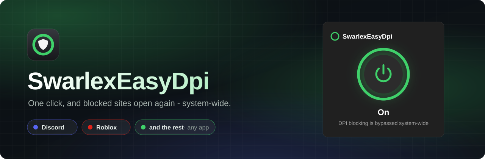
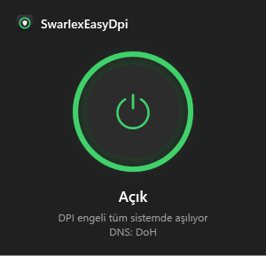
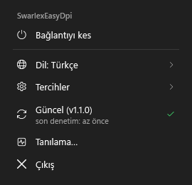
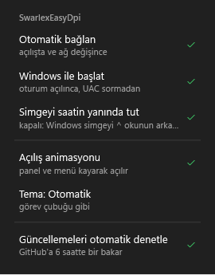

<div align="center">



<br>

**One click, and Discord, Roblox and other blocked sites open again - for every app on your PC.**

[](https://github.com/swarlex/SwarlexEasyDpi/releases/latest)
[](LICENSE)


### [⬇ Download SwarlexEasyDpi.exe](https://github.com/swarlex/SwarlexEasyDpi/releases/latest/download/SwarlexEasyDpi.exe)

<sub>Single file · no installer · updates itself · English &amp; Türkçe</sub>

[Quick start](#quick-start) · [Screenshots](#screenshots) · [Features](#features) · [FAQ](#faq) · [Türkçe](#türkçe) · [Changelog](docs/CHANGELOG.md)

</div>

<br>

SwarlexEasyDpi lives next to the clock. It gets around DPI blocking - the kind of filtering that blocks Discord,
Roblox and other sites in Turkey and elsewhere - for the whole system: browsers, the Discord app and games
alike. There is nothing to configure: it connects on its own and finds a working setting by itself.

## Quick start

1. **[Download `SwarlexEasyDpi.exe`](https://github.com/swarlex/SwarlexEasyDpi/releases/latest/download/SwarlexEasyDpi.exe)**
   and double-click it. If SmartScreen warns, choose *More info > Run anyway*.
2. **Allow administrator rights** once - the packet filter driver needs them. The app copies itself to
   `C:\Program Files\SwarlexEasyDpi` and runs from there.
3. **That's it.** The icon next to the clock turns green when the bypass is on. Right-click > *Preferences* >
   *Start with Windows* to have it start silently at every sign-in.

> [!NOTE]
> Windows 10 or 11 (64-bit). Antivirus programs may flag the packet filter (WinDivert) as a "HackTool"
> because it intercepts network packets - that is how the bypass works. The exe is not code-signed; you can
> [build it yourself](#building).

## Screenshots

<table>
  <tr>
    <td align="center"><br><sub><b>Left click: the panel</b></sub></td>
    <td align="center"><br><sub><b>Right click: the menu</b></sub></td>
    <td align="center"><br><sub><b>Preferences</b></sub></td>
  </tr>
</table>

## Features

- **One button.** Left-click the icon for the panel: a big on/off button that spins while connecting and glows
  green when the bypass is on.
- **Nothing to choose.** Turning it on tries the settings that are known to work in Turkey, one after another,
  until Discord answers through it - and starts with the one that worked next time.
- **Stays connected.** After the network changes or the PC wakes up, it checks again and reconnects if needed.
- **One process.** The DPI engine runs inside the app itself: no extra programs, no services, no console windows.
- **Updates itself** from this page, SHA-256 checked, with one click.
- **Light and dark**, like your taskbar; **English and Turkish**; free and open source (GPL-3.0).

## FAQ

<details>
<summary><b>Which sites does it open?</b></summary>

All of them that are blocked by DPI (SNI filtering), for every app - not a list. It does not hide your IP
address or what you do: it is not a VPN.
</details>

<details>
<summary><b>Does it change my DNS?</b></summary>

No setting is changed. If your provider also blocks by DNS, SwarlexEasyDpi answers DNS queries itself over
encrypted DNS (DNS-over-HTTPS to Cloudflare, Google as fallback) while it is on; the panel then shows
*DNS: DoH*. Turn it off and everything is as before.
</details>

<details>
<summary><b>The icon is orange or red.</b></summary>

Orange: the bypass is on, but Discord could not be reached to confirm it (often: no internet yet). It is checked
again when the network changes. Red: right-click > *Diagnostics…* opens the log - attach it to a
[bug report](https://github.com/swarlex/SwarlexEasyDpi/issues/new?template=bug_report.yml).
</details>

<details>
<summary><b>How do I remove it?</b></summary>

Right-click > *Preferences* > turn off *Start with Windows*, then *Exit*, and delete `C:\Program Files\SwarlexEasyDpi`.
</details>

## Building

Nothing to install: the C# compiler that ships with Windows builds the app; the C compiler
([llvm-mingw](https://github.com/mstorsjo/llvm-mingw)) and the signed WinDivert driver are downloaded once,
SHA-256 checked.

```powershell
powershell -ExecutionPolicy Bypass -File build.ps1 -Test
```

Output: `dist\SwarlexEasyDpi.exe` and its `.sha256`. See [CONTRIBUTING](.github/CONTRIBUTING.md).

---

## Türkçe

DPI engellerini (Discord, Roblox ve diğer engelli siteler) **tüm sistemde** aşar: tarayıcı, Discord uygulaması
ve oyunlar dahil. Ayar yok: kendisi bağlanır, çalışan ayarı kendisi bulur.

1. **[SwarlexEasyDpi.exe'yi indirin](https://github.com/swarlex/SwarlexEasyDpi/releases/latest/download/SwarlexEasyDpi.exe)**
   ve çift tıklayın (SmartScreen uyarırsa *Ek bilgi > Yine de çalıştır*).
2. **Bir kez yönetici izni verin** (paket filtresi sürücüsü için). Program kendini
   `C:\Program Files\SwarlexEasyDpi` klasörüne kopyalar.
3. **Bu kadar.** Saatin yanındaki simge yeşilse açık. Sağ tık > *Tercihler* > *Windows ile başlat*.

Sol tık: büyük aç/kapat düğmeli panel. Sağ tık: menü (Dil, Tercihler, güncellemeler, tanılama).
Simge: yeşil = açık, dönen = bağlanıyor, soluk = kapalı, turuncu = açık ama doğrulanamadı, kırmızı = hata.

## License

GPL-3.0-or-later. The bundled third-party components keep their own licenses:
[THIRD_PARTY_NOTICES](docs/THIRD_PARTY_NOTICES.md). Security: [SECURITY.md](.github/SECURITY.md).
