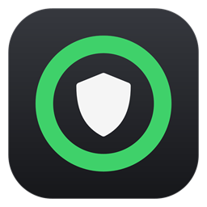

<p align="center">
  
</p>

<h1 align="center">SwarlexEasyDpi</h1>

<p align="center">
  <a href="https://github.com/swarlex/SwarlexEasyDpi/releases/latest"></a>
  
  <a href="LICENSE"></a>
</p>

<p align="center">
  <a href="https://github.com/swarlex/SwarlexEasyDpi/releases/latest/download/SwarlexEasyDpi.exe"><b>⬇ Download SwarlexEasyDpi.exe</b></a>
  <br>
  <sub>One file · no install · updates itself</sub>
</p>

<p align="center"><a href="#english">English</a> · <a href="#türkçe">Türkçe</a></p>

---

<p align="center">
  
  &nbsp;&nbsp;
  
</p>

## English

Bypasses DPI blocking (Discord, Roblox and other blocked sites) **system-wide**, from one small icon next
to the clock. Built on [GoodbyeDPI](https://github.com/ValdikSS/GoodbyeDPI), compiled from source.

- **One click:** it connects as soon as it starts. Left-click the icon for the panel (one big on/off
  button), right-click for the menu.
- **No settings to pick:** it tries the settings known to work in Turkey one after another, stays on the
  first one that Discord answers through, and starts with that one next time.
- **Stays connected:** after the network changes or the PC wakes up, it checks the connection again and
  reconnects if needed (*Connect automatically*).
- **Updates itself** from this page (SHA-256 checked). **English and Turkish.** Free and open source (GPL-3.0).

### Use

1. Download **SwarlexEasyDpi.exe** and run it. It asks for administrator rights once (the WinDivert
   packet driver needs them) and copies itself to `C:\Program Files\SwarlexEasyDpi`.
2. That's it: the icon turns green when the bypass is on. Right-click > *Start with Windows* to have it
   start silently at every logon (no UAC prompt).

Icon: green ring = on, spinning = connecting, dim = off, orange = on but not verified, red = error.

> [!NOTE]
> The exe is not code-signed: SmartScreen may warn on the first launch (*More info* > *Run anyway*), and
> antivirus programs may flag GoodbyeDPI / WinDivert as a "HackTool" because it intercepts network packets.
> You can [build it yourself](#building).

### Credits

| Project | Used for |
|---|---|
| [ValdikSS/GoodbyeDPI](https://github.com/ValdikSS/GoodbyeDPI) | The engine (`native/goodbyedpi`, built from source) and its signed WinDivert driver |
| [cagritaskn/GoodbyeDPI-Turkey](https://github.com/cagritaskn/GoodbyeDPI-Turkey), [Pudochu/goodbyedpi-turkey](https://github.com/Pudochu/goodbyedpi-turkey) | Settings for Turkey |
| [tm4to/easydpi](https://github.com/tm4to/easydpi) | Try settings until Discord answers, remember the working one |
| [swarlex/SwarlexBattery](https://github.com/swarlex/SwarlexBattery) | Tray icon, panel and menu, updater |

### Building

Nothing to install: the C# compiler that ships with Windows builds the app; the C compiler
([llvm-mingw](https://github.com/mstorsjo/llvm-mingw)) and WinDivert are downloaded once, SHA-256 checked.

```powershell
powershell -ExecutionPolicy Bypass -File build.ps1 -Test
```

Output: `dist\SwarlexEasyDpi.exe` and its `.sha256`. Releases are built by `tools\release.ps1`.

---

## Türkçe

DPI engellerini (Discord, Roblox ve diğer engelli siteler) **tüm sistemde** aşar; saatin yanındaki küçük
bir simgeden çalışır. Kaynaktan derlenen [GoodbyeDPI](https://github.com/ValdikSS/GoodbyeDPI) üzerine kuruludur.

- **Tek tık:** açılır açılmaz bağlanır. Simgeye sol tık: panel (büyük aç/kapat düğmesi); sağ tık: menü.
- **Ayar seçmek yok:** Türkiye'de çalıştığı bilinen ayarları sırayla dener, Discord'a ilk ulaşılan ayarda
  kalır ve bir sonraki açılışta doğrudan onunla başlar.
- **Bağlı kalır:** ağ değişince ya da bilgisayar uykudan uyanınca bağlantıyı yeniden dener
  (*Otomatik bağlan*).
- **Kendini günceller** (SHA-256 kontrollü). **Türkçe ve İngilizce.** Ücretsiz ve açık kaynak (GPL-3.0).

### Kullanım

1. **SwarlexEasyDpi.exe**'yi indirip çalıştırın. Bir kez yönetici izni ister (WinDivert sürücüsü için) ve
   kendini `C:\Program Files\SwarlexEasyDpi` klasörüne kopyalar.
2. Bu kadar: atlatma açıkken simge yeşil olur. Sağ tık > *Windows ile başlat* ile her oturum açılışında
   UAC sormadan, sessizce başlar.

Simge: yeşil halka = açık, dönen = bağlanıyor, soluk = kapalı, turuncu = açık ama doğrulanamadı, kırmızı = hata.

> [!NOTE]
> Exe imzalı değil: SmartScreen ilk açılışta uyarabilir (*Ek bilgi* > *Yine de çalıştır*); antivirüsler
> GoodbyeDPI / WinDivert'i ağ paketlerini yakaladığı için "HackTool" diye işaretleyebilir.
> [Kendiniz derleyebilirsiniz](#building).

Güvenlik incelemesi: [docs/GUVENLIK-RAPORU.md](docs/GUVENLIK-RAPORU.md) · [SECURITY.md](.github/SECURITY.md)

## License

GPL-3.0-or-later (code adapted from SwarlexBattery is GPL-3.0). GoodbyeDPI: Apache-2.0. WinDivert:
LGPL-3.0 / GPL-2.0.
